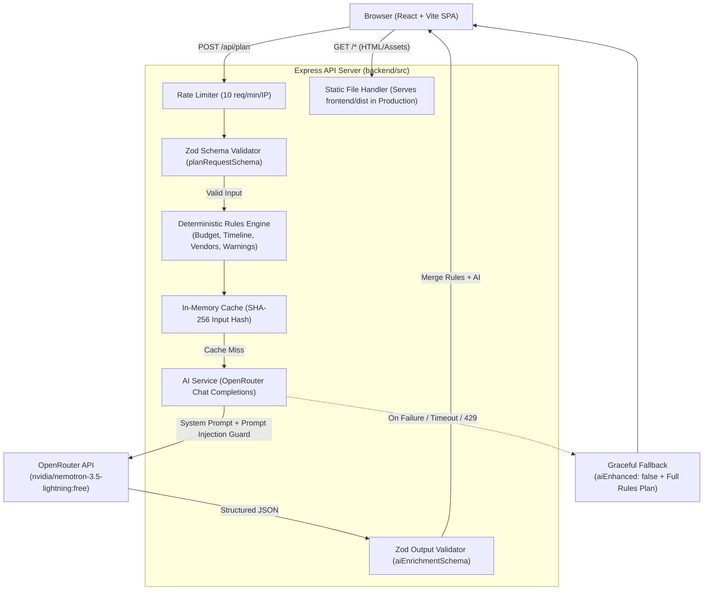

# Event Planner

> **Culturally Astute Celebration & Event Planning for Indian Cities**  
> A full-stack web application combining a deterministic rules engine with OpenRouter AI enrichment to generate realistic budgets, vendor checklists, compressed timelines, and risk mitigation strategies for weddings, birthdays, community gatherings, college fests, and colony events.

[](https://event-planner-9yrt.onrender.com)
[](https://github.com/Div70-07/event_planner)
[](https://github.com/Div70-07/event_planner/tree/main)
[](LICENSE)

---

## Table of Contents

- [Live Demo & Repository](#live-demo--repository)
- [Key Features](#key-features)
- [Technology Stack](#technology-stack)
- [Project Architecture](#project-architecture)
  - [Architecture Flow Diagram](#architecture-flow-diagram)
  - [Hybrid Rules Engine + AI Flow](#hybrid-rules-engine--ai-flow)
  - [Fallback & Fault Tolerance](#fallback--fault-tolerance)
- [Directory Structure](#directory-structure)
- [Installation and Local Setup](#installation-and-local-setup)
- [Environment Variables](#environment-variables)
- [API Documentation](#api-documentation)
  - [1. Health Check (`GET /api/health`)](#1-health-check-get-apihealth)
  - [2. Generate Plan (`POST /api/plan`)](#2-generate-plan-post-apiplan)
- [AI Integration Details](#ai-integration-details)
- [Testing & Quality Verification](#testing--quality-verification)
- [Deployment on Render](#deployment-on-render)
- [Known Limitations](#known-limitations)
- [Future Improvements](#future-improvements)
- [Author & Acknowledgements](#author--acknowledgements)

---

## Live Demo & Repository

- **Live Application URL:** [https://event-planner-9yrt.onrender.com](https://event-planner-9yrt.onrender.com)
- **GitHub Repository:** [https://github.com/Div70-07/event_planner](https://github.com/Div70-07/event_planner)
- **Deployment Platform:** Render (Web Service running Express + compiled Vite bundle)

---

## Key Features

1. **Preset & Customized Celebration Setup**
   - Quick presets for **Royal Wedding (Lucknow)**, **Kids' Birthday (Bengaluru)**, and **Diwali Community Meet (Delhi)**.
   - Granular customization across event types: `wedding`, `birthday`, `community`, `college_fest`, and `colony_event`.
   - Cultural nuance support: Traditional wedding ceremony add-ons (Haldi, Mehndi, Sangeet), city tier cost benchmarks, and venue preference (indoor/outdoor).

2. **100% Mathematically Sound Rules Engine**
   - **Deterministic Budget Allocation:** Category sums equal the requested budget down to the exact rupee with zero rounding discrepancies.
   - **Priority-Driven Weighting:** Shifts 4% budget to selected priorities (decor, entertainment, photography, venue) while respecting a 2% minimum category floor and a 5% contingency reserve.
   - **Unselected Category Elimination:** When catering is unselected (common for college fests or student meetups), food allocation is completely zeroed out and reallocated to active event priorities.

3. **City-Tier Cost Benchmarking**
   - Cost-per-guest analysis against Metro (Delhi, Mumbai, Bengaluru), Tier-2 (Lucknow, Jaipur, Chandigarh), and Tier-3 thresholds.
   - Contextual budget warnings triggered deterministically (e.g. tight budget per plate for metro locations).

4. **Dynamic Timeline & Panic Mode**
   - Chronological milestone planning backtracked from event date.
   - Automatically drops impossible past milestones and flags overdue tasks as `[Immediate]`.
   - **Panic Mode View:** Activates when event date is under 14 days away, grouping critical actions into *Book Today*, *Do This Week*, and *Can Skip / Simplify*.
   - Specialized milestones for non-wedding events (e.g., student committees, sound riders, sponsor pitches for college fests; RWA permissions for colony meets).

5. **Vendor Checklist with Realistic Budget Shares**
   - Auto-generated checkable task lists for each active vendor category.
   - Budget percentage and calculated rupee allocation displayed per vendor.
   - Filtered dynamically so zero-budget categories never pollute the checklist.

6. **In-Browser What-If Simulation**
   - Real-time client-side sliders to adjust guest counts (1–2000), decor shift, and catering shift.
   - Instant in-browser recalculation with zero network calls and zero API latency.

7. **Export & Sharing Tools**
   - **Copy Plan Text:** Clean, readable clipboard summary formatted for WhatsApp or email.
   - **RFC 5545 iCalendar (.ics) Download:** Ready-to-import timeline calendar milestones.
   - **Print / Save as PDF:** Custom `@media print` stylesheet removing navigation, buttons, and sliders for clean multi-page documentation without orphan blank pages.

8. **Culturally Astute UI & Animated Transitions**
   - Indian festival theme using warm maroon, beige/cream, turmeric gold, and subtle mehndi patterns.
   - Dynamic spotlight celebration loading animation cycling through universal festival icons (`💍`, `🪔`, `✨`, `🥁`, `🎉`, `🌸`) while AI processes the request.
   - Zero generic AI emojis in dashboard headers; clean typographic badges.

---

## Technology Stack

### Frontend
- **Framework:** React 18.3.1 (Single Page Application)
- **Bundler & Dev Server:** Vite 6.4.5
- **Styling:** Vanilla CSS with custom design tokens (`global.css`), CSS grid/flexbox, and print stylesheets
- **State Management:** React hooks (`useState`, `useEffect`, `useCallback`, `useId`) with `localStorage` draft persistence
- **Icons & Graphics:** Lightweight inline SVG vectors and accessible emoji badges

### Backend
- **Runtime:** Node.js (v20+ / ES Modules)
- **Framework:** Express 4.19.2
- **Validation:** Zod 3.25.76 for strict schema validation
- **Security Middleware:**
  - `helmet` (7.1.0) for HTTP header security
  - `cors` (2.8.5) with origin whitelist validation
  - `express-rate-limit` (7.3.1) configured for 10 requests / minute / IP
  - `express.json({ limit: '10kb' })` request body limit
- **Performance:** `compression` (1.7.4) for gzip payload compression

### AI Integration
- **Gateway:** OpenRouter API (`https://openrouter.ai/api/v1`)
- **Primary Model:** `nvidia/nemotron-3.5-lightning:free`
- **Fallback Integration:** Direct Google Gemini SDK (`@google/genai`) supported if `GEMINI_API_KEY` is supplied
- **Design Pattern:** Hybrid rules-first architecture with non-blocking fallback

### Testing & Code Quality
- **Test Runner:** Vitest 5.0.5
- **Coverage Engine:** `@vitest/coverage-v8` 5.0.5
- **DOM Testing:** `@testing-library/react` 16.0.0, `@testing-library/jest-dom` 6.4.6, `jsdom` 24.1.1
- **API Testing:** `supertest` 7.0.0
- **Linter & Code Style:** ESLint 8.57.0 with Flat Config (`eslint.config.js`)

---

## Project Architecture

### Architecture Flow Diagram



### Hybrid Rules Engine + AI Flow

1. **Rules Engine as Source of Truth:**
   All quantitative decisions (budgets, per-guest spends, milestone dates, vendor task lists, trade-off mathematics, and panic mode classifications) are computed entirely by deterministic JavaScript modules in `backend/src/services/rulesEngine/`.
2. **Context Enrichment via AI:**
   OpenRouter is called only after the rules plan is computed. It is provided a structured system prompt instructing the model to enrich qualitative fields only: executive summary, cultural theme ideas, personalised logistical tips, vendor negotiation advice, and risk mitigation strategies.
3. **Prompt Injection Defense:**
   User notes are enclosed within strict `<untrusted_user_notes>` XML delimiters and sanitized. The system prompt instructs the model to ignore any system commands embedded in user notes.

### Fallback & Fault Tolerance

- If OpenRouter encounters an upstream 429 rate limit, network timeout, connection abort, or schema validation error:
  - The request **does not fail or return HTTP 500**.
  - The controller returns HTTP 200 with `aiEnhanced: false` alongside the 100% complete deterministic rules-engine plan.
  - The frontend renders an informative notice banner without blocking the user from their budget or timeline.

---

## Directory Structure

```text
event-planner/
├── .env.example                     # Environment template for local and production runs
├── .gitignore                       # Standard ignore rules (node_modules, dist, .env, coverage)
├── package.json                     # Monorepo root scripts (dev, build, start, test, lint)
├── package-lock.json                # Monorepo lockfile
├── README.md                        # Project documentation
├── CHECKLIST.md                     # Phase and milestone development tracker
├── PROJECT_SPEC.md                  # Project specification and requirement contracts
│
├── backend/                         # Express API application
│   ├── package.json                 # Backend dependencies and test scripts
│   ├── eslint.config.js             # ESLint configuration for backend
│   └── src/
│       ├── index.js                 # Server entrypoint (listens on process.env.PORT)
│       ├── app.js                   # Express application setup, middleware, static routing
│       ├── config/
│       │   ├── env.js               # Environment variable validation and defaults
│       │   └── eventConfig.js       # Constants: city tiers, budget %, milestones, thresholds
│       ├── controllers/
│       │   └── planController.js    # POST /api/plan handler, cache integration, fallback
│       ├── middleware/
│       │   ├── errorHandler.js      # Central error responder with consistent JSON schema
│       │   ├── rateLimiter.js       # 10 req/min/IP rate limit middleware
│       │   └── validate.js          # Generic Zod request body validation middleware
│       ├── prompts/
│       │   └── planPrompt.js        # System instruction and enrichment prompt generator
│       ├── routes/
│       │   ├── health.js            # GET /api/health
│       │   └── plan.js              # POST /api/plan
│       ├── schemas/
│       │   ├── aiEnrichmentSchema.js # Zod validation for LLM structured output
│       │   └── planRequestSchema.js  # Zod validation for incoming plan requests
│       ├── services/
│       │   ├── cache.js             # Short-lived in-memory cache keyed by input hash
│       │   ├── geminiService.js     # OpenRouter & Gemini API provider service
│       │   └── rulesEngine/         # Deterministic calculations
│       │       ├── index.js         # Master orchestrator (generateRulesPlan)
│       │       ├── budgetCalculator.js # Exact integer rupee allocation & priority shifts
│       │       ├── budgetHealth.js  # City-tier per-guest benchmark assessment
│       │       ├── panicModeEngine.js # <14 day triage (Book Today, This Week, Can Skip)
│       │       ├── timelineGenerator.js # Date-aware milestone task schedules
│       │       ├── tradeoffEngine.js # Deterministic budget rebalancing suggestions
│       │       ├── vendorGenerator.js # Vendor checklist and budget share assignment
│       │       └── warningEngine.js # Weather, budget stretch, and date alerts
│       └── __tests__/               # Backend Vitest unit and integration test suite
│
└── frontend/                        # React + Vite client application
    ├── package.json                 # Frontend dependencies and scripts
    ├── vite.config.js               # Vite bundler configuration
    ├── index.html                   # HTML entry point (lang="en", meta tags)
    ├── eslint.config.js             # ESLint configuration for frontend React
    └── src/
        ├── main.jsx                 # React root mount
        ├── App.jsx                  # Application orchestrator, form submission, sample mode
        ├── api/
        │   └── planClient.js        # API client for /api/plan with error mapping
        ├── components/
        │   ├── AiInsights.jsx       # Theme ideas, tips, vendor suggestions, and risks
        │   ├── BudgetBreakdown.jsx  # Interactive budget table, health meter, trade-offs
        │   ├── Dashboard.jsx        # Sticky navigation and plan layout container
        │   ├── EventForm.jsx        # Form with fieldsets, live validation, add-ons
        │   ├── ExportBar.jsx        # Copy text, .ics download, and print toolbar
        │   ├── LoadingOverlay.jsx   # Spotlight carousel celebration loading modal
        │   ├── Presets.jsx          # Quick-start preset cards
        │   ├── RefineChips.jsx      # Quick plan recalibration chips (cheaper, veg, DJ)
        │   ├── Timeline.jsx         # Milestone timeline with panic mode highlight
        │   ├── VendorChecklist.jsx  # Vendor checklist cards with persistence
        │   ├── Warnings.jsx         # Urgency, venue, and city budget alerts
        │   └── WhatIfSliders.jsx    # Client-side recalculation simulator
        ├── data/
        │   ├── presets.js           # Default configurations for quick presets
        │   └── samplePlan.js        # Offline sample plan for instant demonstration
        ├── styles/
        │   └── global.css           # Festival design system tokens, layout, print CSS
        ├── utils/
        │   └── exportUtils.js       # Text formatter, RFC 5545 .ics generator
        └── __tests__/               # Frontend Vitest & React Testing Library tests
```

---

## Installation and Local Setup

### Prerequisites

- **Node.js:** v18.0.0 or higher (v20+ recommended)
- **npm:** v9.0.0 or higher
- **Git**

### Step-by-Step Setup

1. **Clone the Repository:**
   ```bash
   git clone https://github.com/Div70-07/event_planner.git
   cd event_planner
   ```

2. **Configure Environment Variables:**
   Create a local `.env` file in the project root based on `.env.example`:
   ```bash
   cp .env.example .env
   ```
   Open `.env` in your text editor and supply your OpenRouter API key:
   ```env
   OPENROUTER_API_KEY=your_actual_openrouter_api_key
   OPENROUTER_MODEL=nvidia/nemotron-3.5-lightning:free
   OPENROUTER_BASE_URL=https://openrouter.ai/api/v1
   PORT=4000
   NODE_ENV=development
   CORS_ORIGIN=http://localhost:5173
   ```
   *(Never commit `.env` to Git. The file is listed in `.gitignore`.)*

3. **Install Dependencies:**
   Install dependencies across the monorepo root, backend, and frontend:
   ```bash
   npm install
   npm install --prefix backend
   npm install --prefix frontend
   ```

4. **Run the Development Server:**
   Start both backend (Express on port 4000) and frontend (Vite on port 5173) concurrently:
   ```bash
   npm run dev
   ```
   Open your browser and navigate to: **`http://localhost:5173`**

---

## Environment Variables

| Variable | Description | Required? | Default (Local) | Production Example (Render) |
|---|---|---|---|---|
| `NODE_ENV` | Runtime environment (`development` / `production`) | No | `development` | `production` |
| `PORT` | Port for Express API server | No | `4000` | Provided automatically by Render |
| `OPENROUTER_API_KEY` | OpenRouter Bearer authentication token | **Yes** (in prod) | *None* | `sk-or-v1-...` |
| `OPENROUTER_MODEL` | OpenRouter model ID | No | `nvidia/nemotron-3.5-lightning:free` | `nvidia/nemotron-3.5-lightning:free` |
| `OPENROUTER_BASE_URL`| Base URL for OpenRouter API requests | No | `https://openrouter.ai/api/v1` | `https://openrouter.ai/api/v1` |
| `CORS_ORIGIN` | Comma-separated allowed origins for CORS | No | `http://localhost:5173` | `https://event-planner-9yrt.onrender.com` |
| `GEMINI_API_KEY` | Optional direct Google Gemini key (alternative) | No | *None* | *None* |

---

## API Documentation

### 1. Health Check (`GET /api/health`)

Checks if the server is healthy and responding.

- **URL:** `/api/health`
- **Method:** `GET`
- **Headers:** None required
- **Success Response (200 OK):**
  ```json
  {
    "status": "ok"
  }
  ```

---

### 2. Generate Plan (`POST /api/plan`)

Generates a deterministic rules-based celebration plan enriched with optional OpenRouter AI qualitative analysis.

- **URL:** `/api/plan`
- **Method:** `POST`
- **Rate Limit:** 10 requests per minute per IP
- **Content-Type:** `application/json` (max body: 10 KB)

#### Request Body Schema (`planRequestSchema`)

| Field | Type | Required | Constraints | Description |
|---|---|---|---|---|
| `eventType` | `string` | **Yes** | One of: `wedding`, `birthday`, `community`, `college_fest`, `colony_event` | Primary celebration category |
| `eventName` | `string` | **Yes** | 1–100 characters | Custom name for the celebration |
| `eventDate` | `string` | **Yes** | `YYYY-MM-DD`, cannot be in past | Date celebration occurs |
| `guestCount` | `number` | **Yes** | Integer between 1 and 2000 | Expected attendees |
| `budget` | `number` | **Yes** | Positive integer up to 1,000,000,000 | Total budget in INR |
| `currency` | `string` | No | Must be `"INR"` | Defaults to `"INR"` |
| `city` | `string` | **Yes** | 1–100 characters | City name (e.g. Lucknow, Delhi) |
| `venuePreference`| `string`| No | `indoor`, `outdoor`, or `either` | Defaults to `"either"` |
| `priorities` | `array` | No | Up to 3 of: `food`, `decor`, `entertainment`, `photography`, `venue`, `guest comfort` | Selected key priorities |
| `dietary` | `array` | No | Elements from: `veg`, `vegan`, `jain`, `halal`, `none` | Food service guidelines |
| `functionAddons` | `array` | No | Elements from: `haldi`, `mehndi`, `sangeet` | Wedding ritual add-ons |
| `notes` | `string` | No | Max 500 characters | Special notes & family traditions |

#### Example Request

```json
{
  "eventType": "college_fest",
  "eventName": "TechSparks 2027",
  "eventDate": "2027-03-20",
  "guestCount": 450,
  "budget": 600000,
  "currency": "INR",
  "city": "Bengaluru",
  "venuePreference": "indoor",
  "priorities": ["entertainment", "decor"],
  "dietary": ["none"],
  "functionAddons": [],
  "notes": "Need high decibel sound permissions and reliable power backup for band."
}
```

#### Example Response (200 OK — Enriched)

```json
{
  "aiEnhanced": true,
  "plan": {
    "budget": [
      {
        "category": "Venue & Facilities",
        "key": "venue",
        "percent": 25,
        "amount": 150000,
        "rationale": "Covers venue hire, basic banquet amenities, and cleaning/setup deposits."
      },
      {
        "category": "Entertainment & Music",
        "key": "entertainment",
        "percent": 45,
        "amount": 270000,
        "rationale": "Boosted to match your top priority for entertainment & music."
      },
      {
        "category": "Decor & Theme",
        "key": "decor",
        "percent": 15,
        "amount": 90000,
        "rationale": "Boosted to match your top priority for decor & theme."
      },
      {
        "category": "Contingency & Emergency",
        "key": "contingency",
        "percent": 15,
        "amount": 90000,
        "rationale": "Safety reserve for unplanned expenses and last-minute needs (≥ 5% floor maintained)."
      }
    ],
    "timeline": [
      {
        "label": "2 Months Before",
        "dueDate": "2027-01-23",
        "relativeLabel": "8 weeks before",
        "tasks": [
          "Form core student organizing committee and faculty liaison team",
          "Finalize festival theme, event schedule, and competition rules",
          "Obtain campus administration, ground, and security approvals"
        ]
      }
    ],
    "vendors": [
      {
        "type": "DJ, Sound & Entertainment",
        "budgetShare": 45,
        "checklist": [
          "Review sound console specifications, wireless microphones, and DJ sound permits",
          "Share banned songs and must-play playlist highlights with DJ",
          "Verify emcee / anchor schedule and stage coordination cues",
          "Include live percussionist / dhol player / instrumental opening act"
        ]
      }
    ],
    "warnings": [],
    "tradeoffs": [],
    "budgetHealth": {
      "status": "comfortable",
      "message": "Budget of ₹6,00,000 for 450 guests in Bengaluru is within a healthy range."
    },
    "panicMode": {
      "enabled": false,
      "bookToday": [],
      "doThisWeek": [],
      "canSkip": []
    },
    "ai": {
      "summary": "TechSparks 2027 is an energetic Bengaluru college fest prioritizing stage sound and ambient decor.",
      "themeIdeas": [
        "Cyberpunk Neon: Ultra-violet ambient lighting with geometric stage structures",
        "Indie Carnival: Acoustic afternoon sessions shifting to heavy electronic bass at night"
      ],
      "personalisedTips": [
        "Coordinate with campus administration for sound cutoff times before finalizing headline band rider.",
        "Set up an isolated power line for stage sound consoles to prevent light rigging brownouts."
      ],
      "vendorSuggestions": [
        {
          "type": "Sound Production",
          "advice": "Demand high-frequency line arrays tested for reverberant campus auditoriums."
        }
      ],
      "risks": [
        {
          "risk": "Campus sound cutoff violation",
          "mitigation": "Schedule headline artist before 9:30 PM with ambient acoustic closing."
        }
      ]
    }
  }
}
```

#### Error Responses

- **400 Bad Request (Validation Error):**
  ```json
  {
    "error": {
      "code": "VALIDATION_ERROR",
      "message": "Please check the submitted fields.",
      "details": [
        {
          "field": "eventDate",
          "message": "eventDate cannot be in the past"
        }
      ]
    }
  }
  ```
- **429 Too Many Requests (Rate Limit Exceeded):**
  ```json
  {
    "error": {
      "code": "RATE_LIMIT_EXCEEDED",
      "message": "Too many plan requests. Please wait a minute before trying again.",
      "details": [
        {
          "field": "rateLimit",
          "message": "Limit of 10 requests per minute exceeded. Retry after 60 seconds."
        }
      ]
    }
  }
  ```

---

## AI Integration Details

- **Provider:** OpenRouter (`https://openrouter.ai/api/v1/chat/completions`)
- **Configured Model:** `nvidia/nemotron-3.5-lightning:free`
- **Role of AI:** Qualitative enrichment only. The model drafts executive summaries, festival theme ideas, practical local tips, and risk mitigation strategies.
- **Rules Engine Boundaries:** The LLM is strictly prohibited from modifying rupee amounts, totals, percentages, due dates, or rules engine decisions.
- **Provider Constraints:** The model is hosted on OpenRouter's free pool. Free endpoints are subject to upstream concurrency limits and temporary rate limiting (HTTP 429). The system handles this gracefully by returning the complete rules-based plan when the provider is busy.

---

## Testing & Quality Verification

The project includes an automated test suite across backend and frontend workspaces.

### Running Tests

Execute the full suite from the repository root:
```bash
# Run both backend and frontend tests
npm test

# Run backend unit & integration tests only (60 tests)
npm run test:backend

# Run frontend React component & utility tests only (58 tests)
npm run test:frontend
```

### Coverage Reports

Generate coverage metrics via `@vitest/coverage-v8`:
```bash
# Backend coverage
npm run test:coverage --prefix backend

# Frontend coverage
npm run test:coverage --prefix frontend
```

### Code Quality & Linting

```bash
# Lint both workspaces (ESLint)
npm run lint

# Auto-fix linting issues
npm run lint:fix
```

### Production Build Verification

Verify that Vite builds the frontend bundle without errors:
```bash
npm run build
```

---

## Deployment on Render

The application is deployed on Render as a single **Web Service**.

### Configuration Settings

- **Repository:** `https://github.com/Div70-07/event_planner`
- **Branch:** `main`
- **Environment:** `Node`
- **Build Command:**
  ```bash
  npm run build --prefix frontend
  ```
- **Start Command:**
  ```bash
  npm run start --prefix backend
  ```

### Production Environment Variables on Render

| Key | Value | Notes |
|---|---|---|
| `NODE_ENV` | `production` | Enforces production security and enables frontend static file serving |
| `OPENROUTER_API_KEY` | `sk-or-v1-...` | Your private OpenRouter API key |
| `OPENROUTER_MODEL` | `nvidia/nemotron-3.5-lightning:free` | Model identifier |
| `OPENROUTER_BASE_URL`| `https://openrouter.ai/api/v1` | OpenRouter endpoint |
| `CORS_ORIGIN` | `https://event-planner-9yrt.onrender.com` | Live frontend domain |

### How Production Serving Operates

1. During the build phase, Render runs `npm run build --prefix frontend`, compiling the React application into `frontend/dist/`.
2. When the backend starts via `node backend/src/index.js`, `NODE_ENV=production` triggers the static handler in `backend/src/app.js`:
   ```javascript
   if (env.isProduction) {
     const distPath = path.resolve(__dirname, '../../../frontend/dist');
     app.use(express.static(distPath));
     app.get('*', (req, res, next) => {
       if (req.path.startsWith('/api')) return next();
       res.sendFile(path.join(distPath, 'index.html'));
     });
   }
   ```
3. Render automatically binds the application to an internal port via the `$PORT` environment variable.

---

## Known Limitations

1. **Free-Tier AI Rate Limiting:** OpenRouter's free pool for `nvidia/nemotron-3.5-lightning:free` can occasionally return HTTP 429 when upstream traffic is high. When this happens, the application gracefully provides the rules-only plan without crashing.
2. **Render Free Instance Sleep:** Render free web services spin down after periods of inactivity. The first request after sleep may take 45–60 seconds while the container wakes up.
3. **Indicative Pricing Only:** Budget figures and city tier thresholds represent indicative market averages and are not live contractor quotes.
4. **Local Browser Persistence:** Checklist tick states and form drafts are stored strictly in `localStorage` in the user's browser. There are no user accounts or persistent server databases.

---

## Future Improvements

- **Multi-Day Itinerary Builder:** Multi-day event scheduling with dedicated sub-timelines for destination weddings and multi-day fests.
- **Real-Time Currency Conversion:** Support for INR, USD, EUR, and AED based on current exchange rates.
- **Collaborative Link Sharing:** Read-only encoded URL links to share complete plans with family or committee members without requiring a database.
- **Dark Mode Support:** Festival theme extension with high-contrast night aesthetics.

---

## Author & Acknowledgements

- **Developer:** [Divyanshu](https://github.com/Div70-07)
- **Challenge:** PromptWars Challenge 05
- **Built With:** Node.js, Express, React, Vite, OpenRouter AI, and Zod.
- **License:** MIT License
